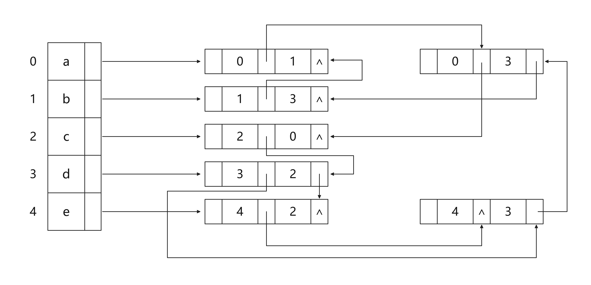
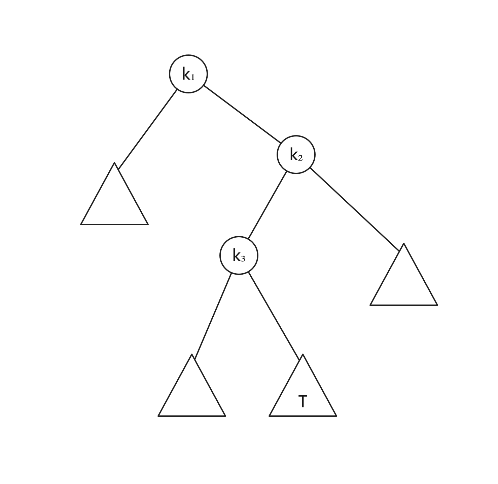
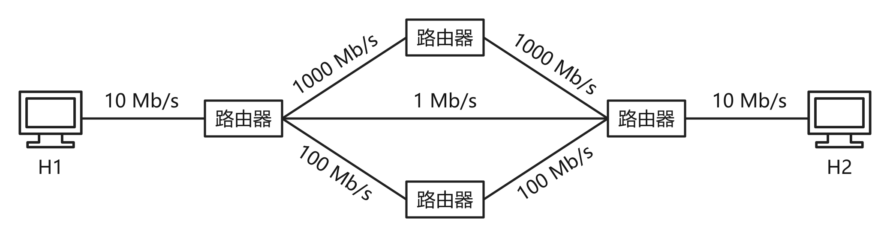
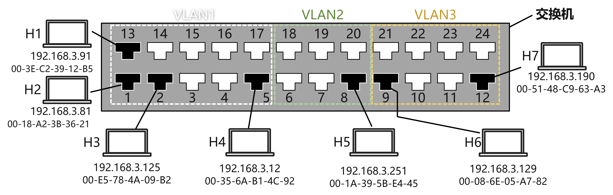
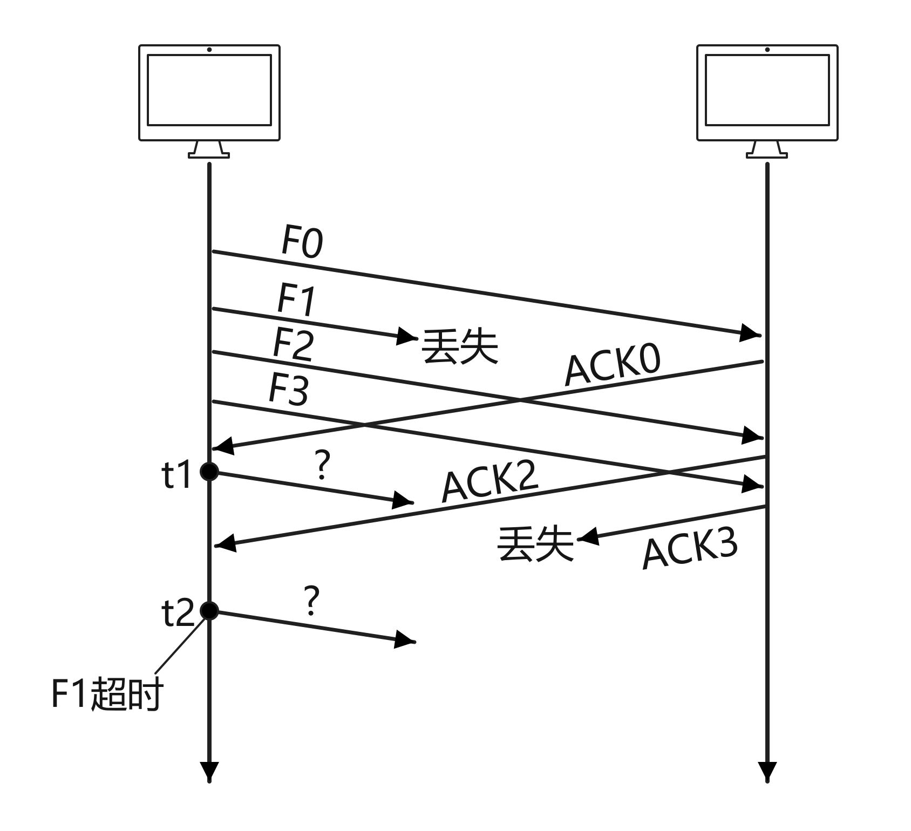
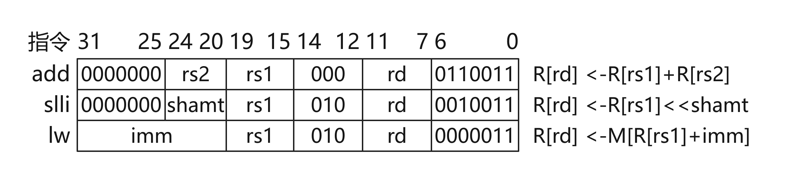
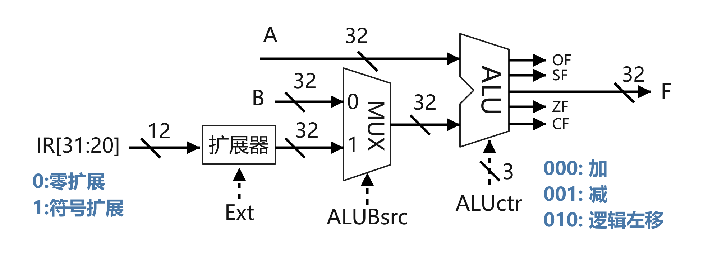
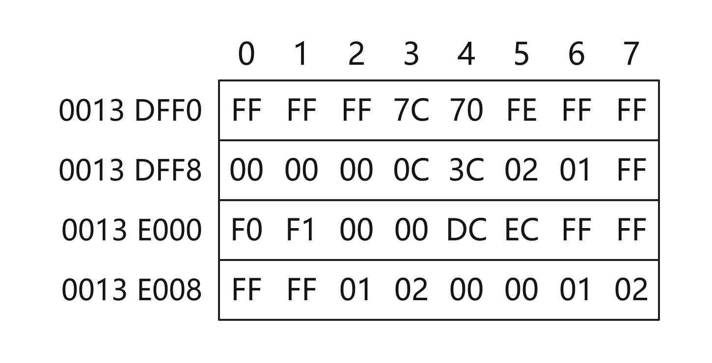
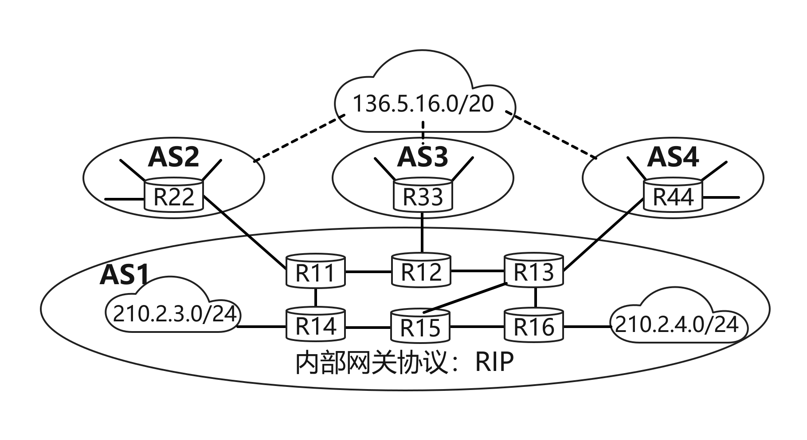

# 2024年408真题

> 来源：四〇八档案室 <https://zhenti.beokayy.club/paper/2024> 的结构化题面，抓取时间 2026-10-28。
> 与 2009–2023 年那份由官方 PDF 经 OCR 生成的版本不同，这份是网页整理的题面；
> 配图取自该站重绘图，存于 `图/2024/`。

## 一、单项选择题（第 1～40 小题，每小题 2 分，共 80 分）

### 1．已知带头结点的非空单链表L的头指针为h，结点结构为 [ data | next ]，其中next是指向直接后继结点的指针。现有指针p和q，若p指向L中非首且非尾的任意一个结点，则执行下列语句序列后的结果是

```c
q = p->next;
p->next = q->next;
q->next = h->next;
h->next = q;
```

- A. 在p所指结点后插入q所指结点
- B. 在q所指结点后插入p所指结点
- C. 将p所指结点移动到L的头结点之后
- D. 将q所指结点移动到L的头结点之后

### 2．与表达式x+y*(z-u)/v等价的后缀表达式是

- A. xyzu-*v/+
- B. xyzu-v/*+
- C. +x/*y-zuv
- D. +x*y/-zuv

### 3．若p、q和v均为二叉树T中的结点，v有两个孩子结点，T的中序遍历序列形如：“…,p,v,q,…”，则下列叙述中，正确的是

- A. p 没有右孩子，q 没有左孩子
- B. p 没有右孩子，q 有左孩子
- C. p 有右孩子，q 没有左孩子
- D. p 有右孩子，q 有左孩子

### 4．若无向图 G=(V, E) 的邻接多重表如下图所示，则 G 中顶点 b 与 d 的度分别是



- A. 0，2
- B. 2，4
- C. 2，5
- D. 3，4

### 5．下列数据结构中，不适合直接使用折半查找的是

Ⅰ. 有序链表
Ⅱ. 无序数组
Ⅲ. 有序静态链表
Ⅳ. 无序静态链表

- A. 仅Ⅰ、Ⅲ
- B. 仅Ⅱ、Ⅳ
- C. 仅Ⅱ、Ⅲ、Ⅳ
- D. Ⅰ、Ⅱ、Ⅲ、Ⅳ

### 6．KMP算法使用修正后的next数组进行模式匹配，模式串S=“aabaab”，当主串中某字符与S中某字符失配时，S将向右滑动的最长距离是

- A. 5
- B. 4
- C. 3
- D. 2

### 7．一棵二叉搜索树如题7图所示，k1、k2、k3分别是对应结点中保存的关键字。子树T的任一结点中保存的关键字x满足的是



- A. x < k1
- B. x > k2
- C. k1 < x < k3
- D. k3 < x < k2

### 8．使用快速排序算法对含n(n≥3)个元素的数组M进行排序，若第一趟排序将M中除枢轴外的n－1个元素划分为均不为空的P和Q两块，则下列叙述中，正确的是

- A. P与Q块间有序
- B. P与Q均块内有序
- C. P和Q的元素个数大致相等
- D. P中和Q中均不存在相等的元素

### 9．已知关键字序列28，22，20，19，8，12，15，5是大根堆（最大堆），对该堆进行两次删除操作后，得到的新堆是

- A. 20，19，15，12，8，5
- B. 20，19，15，5，8，12
- C. 20，19，12，15，8，5
- D. 20，19，8，12，15，5

### 10．现有由关键字组成的3个有序序列（3，5）、（7，9）和（6），若按从左至右的次序选择有序序列进行二路归并排序，则关键字之间的总比较次数是

- A. 3
- B. 4
- C. 5
- D. 6

### 11．在外排序中，利用败者树对初始为升序的归并段进行多路归并，败者树中记录“冠军”的结点保存的是

- A. 最大关键字
- B. 最小关键字
- C. 最大关键字所在的归并段号
- D. 最小关键字所在的归并段号

### 12．C 语言代码段如下。

```c
int i=32777;
short si=i;
int j=si;
```

执行上述代码段后，j 的值是

- A. -32 777
- B. -32 759
- C. 32 759
- D. 32 777

### 13．通常情况下，将汇编语言程序中实现特定功能的指令序列定义成一条伪指令 (pseudoinstruction)。下列选项中，CPU 能理解并直接执行的是
I. 伪指令
II. 微指令
III. 机器指令
IV. 汇编指令

- A. 仅 I、IV
- B. 仅 II、III
- C. 仅 III、IV
- D. 仅 I、III、IV

### 14．某科学实验中，需要使用大量的整型参数，为了在保证表数精度的基础上提高运算速度，需要选择合理的数据表示方法。若整型参数 α、β 的取值范围分别为 -220sim220、-240sim240，则下列选项中，α、β 最适宜采用的数据表示方法分别是

- A. 32位整数、32位整数
- B. 单精度浮点数、单精度浮点数
- C. 32位整数、双精度浮点数
- D. 单精度浮点数、双精度浮点数

### 15．下列关于整数乘法运算的叙述中，错误的是

- A. 用阵列乘法器实现的乘运算可以在一个时钟周期内完成
- B. 用 ALU 和移位器实现的乘运算无法在一个时钟周期内完成
- C. 变量与常数的乘运算可编译优化为若干条移位及加/减运算指令
- D. 两个变量的乘运算无法编译转换为移位及加法等指令的循环实现

### 16．对于页式虚拟存储管理系统，下列关于存储器层次结构的叙述中，错误的是

- A. Cache-主存层次的交换单位为主存块，主存-外存层次的交换单位为页
- B. Cache-主存层次替换算法由硬件实现，主存-外存层次替换算法由软件实现
- C. Cache-主存层次可采用回写法写策略，主存-外存层次通常采用回写法写策略
- D. Cache-主存层次可采用直接映射方式，主存-外存层次通常采用直接映射方式

### 17．某计算机按字节编址，采用页式虚拟存储管理方式，虚拟地址为32位，主存地址为30位，页大小为1 KB。若TLB共有32个表项，采用4路组相联映射方式，则TLB表项中标记字段的位数至少是

- A. 17
- B. 18
- C. 19
- D. 20

### 18．下列事件中，不是在MMU地址转换过程中检测的是

- A. 访问越权
- B. Cache缺失
- C. 页面缺失
- D. TLB缺失

### 19．对于采用“取指、译码/取数、执行、访存、写回”5段流水线的RISC数据通路，下列关于指令流水线数据冒险处理的叙述中，错误的是

- A. 相邻两条指令中的操作数相关可能引起数据冒险
- B. 在数据相关的指令间插入“气泡”能避免数据冒险
- C. 所有数据冒险都可以通过加入转发（旁路）电路解决
- D. 所有数据冒险都能通过调整指令顺序和插入nop指令解决

### 20．某存储器总线的时钟频率为420 MHz，总线宽度为64位，每个时钟周期传送2次数据；其总线事务支持突发传送方式，最多传送8次数据，第1个时钟周期传送地址和读/写命令，从第4个至第7个时钟周期连续传送8次数据。该总线的总线带宽（最大数据传输率）为

- A. 3.84 GB/s
- B. 6.72 GB/s
- C. 30.72 GB/s
- D. 53.76 GB/s

### 21．下列关于中断I/O方式的叙述中，错误的是

- A. 中断屏蔽字用于确定中断响应的优先级
- B. 保存断点和程序状态字在中断响应阶段完成
- C. 保存通用寄存器和设置新中断屏蔽字由软件实现
- D. 单重中断方式下中断处理时CPU处于关中断状态

### 22．DMA控制I/O方式下，设备的输入/输出由DMA控制器控制完成，此时，DMA控制器控制的数据传输通路位于

- A. CPU和主存之间
- B. CPU和DMA控制器之间
- C. 设备接口和主存之间
- D. 设备接口和DMA控制器之间

### 23．下列关于中断、异常和系统调用的叙述中，错误的是

- A. 中断或异常发生时，CPU处于内核态
- B. 每个系统调用都有对应的内核服务例程
- C. 中断处理程序开始执行时，CPU处于内核态
- D. 系统添加新类型设备时，需注册相应的中断服务例程

### 24．下列选项中，操作系统在终止进程时不一定执行的是

- A. 终止子进程
- B. 回收进程占用的设备
- C. 释放进程控制块
- D. 回收为进程分配的内存

### 25．在支持页式存储管理的系统中，进程切换时操作系统需要执行的操作是
Ⅰ. 更新程序计数器的值
Ⅱ. 更新栈基址寄存器的值
Ⅲ. 更新页表基地址寄存器的值

- A. 仅Ⅲ
- B. 仅Ⅰ、Ⅱ
- C. 仅Ⅰ、Ⅲ
- D. Ⅰ、Ⅱ、Ⅲ

### 26．文件系统需占用部分外存空间记录空闲块位置。下列方法中，占用外存空间的大小与当前空闲块数量无关的是

- A. 位图法
- B. 空闲表法
- C. 成组链接法
- D. 空闲链表法

### 27．下列算法中，每次回收分区时仅合并大小相等的空闲分区的是

- A. 伙伴算法
- B. 最佳适应算法
- C. 最坏适应算法
- D. 首次适应算法

### 28．若进程P中的线程T先打开文件，得到文件描述符fd，再创建两个线程Ta和Tb，则下列资源中，Ta与Tb可共享的是
Ⅰ. 进程P的地址空间
Ⅱ. 线程T的栈
Ⅲ. 文件描述符fd

- A. 仅Ⅰ
- B. 仅Ⅰ、Ⅲ
- C. 仅Ⅱ、Ⅲ
- D. Ⅰ、Ⅱ、Ⅲ

### 29．下列系统调用的实现中，包含文件按名查找功能的是

- A. open()
- B. read()
- C. write()
- D. close()

### 30．假设某系统使用时间片轮转调度算法进行CPU调度，时间片大小为5 ms，系统共有10个进程，初始时均处于就绪队列，执行结束前仅处于执行态或就绪态。若队尾的进程P所需CPU时间最短，时间为25 ms，在不考虑系统开销的情况下，则进程P的周转时间为

- A. 200 ms
- B. 205 ms
- C. 250 ms
- D. 295 ms

### 31．键盘中断服务例程执行结束时，所输入数据的存放位置是

- A. 用户缓冲区
- B. CPU中的通用寄存器
- C. 内核缓冲区
- D. 键盘控制器的数据寄存器

### 32．某磁盘的磁道数为 400（磁道号为 0～399），采用循环扫描算法（CSCAN）进行磁盘调度，完成对 200 号磁道的请求后，磁头向磁道号减小的方向移动。若还有 7 个磁盘请求，对应的磁道号分别为 300，120，110，0，160，210，399，则完成上述磁盘访问请求后磁头移动的距离是

- A. 599
- B. 619
- C. 788
- D. 799

### 33．若某分组交换网络及每段链路的带宽如下图所示，则 H1 到 H2 的最大吞吐量约为



- A. 1 Mb/s
- B. 10 Mb/s
- C. 100 Mb/s
- D. 1 000 Mb/s

### 34．在下列二进制数字调制方法中，需要 2 个不同频率载波的是

- A. ASK
- B. PSK
- C. FSK
- D. DPSK

### 35．如题 35 图所示的支持 VLAN 划分的交换机，已按端口划分了 3 个 VLAN，部分端口连接主机的 IP 地址和 MAC 地址如图中所示，ARP 表结构为＜IP 地址，MAC 地址，TTL＞。下列选项中，不会出现在 H4 的 ARP 表中的是



- A. 192.168.3.81, 00-18-A2-3B-36-21, 14:32:00
- B. 192.168.3.91, 00-3E-C2-39-12-B5, 14:37:00
- C. 192.168.3.125, 00-E5-78-4A-09-B2, 14:45:00
- D. 192.168.3.129, 00-08-6E-05-A7-82, 14:52:00

### 36．在采用 CSMA/CA 的 802.11 无线局域网中，DIFS = 128 μs，SIFS = 28 μs，RTS、CTS 和 ACK 帧的传输时延分别是 3 μs、2 μs 和 2 μs，忽略信号传播时延。若主机 A 欲向 AP 发送一个总长度为 1 998 B 的数据帧，无线链路带宽为 54 Mb/s，则隐藏站 B 收到 AP 发送的 CTS 帧时，设置的网络分配向量 NAV 的值是

- A. 326 μs
- B. 354 μs
- C. 385 μs
- D. 513 μs

### 37．主机甲通过选择重传（SR）滑动窗口协议向主机乙发送帧的部分过程如题37图所示，Fx 为数据帧，ACKx 为确认帧，x 是位数为3比特的序号。乙只对正确接收的数据帧进行独立确认，发送窗口与接收窗口大小相同且均为最大值。甲在 t1 时刻和 t2 时刻发送的数据帧分别是



- A. F1, F3
- B. F1, F4
- C. F3, F1
- D. F4, F1

### 38．假设主机 H 通过 TCP 向服务器发送长度为 3 000 B 的报文，往返时间 RTT=10 ms，最长报文段寿命 MSL=30 s，最大报文段长度 MSS=1 000 B，忽略 TCP 段的传输时延，报文传输结束后 H 首先请求断开连接，则从 H 请求建立 TCP 连接时刻起，到 H 进入 CLOSED 状态为止，所需的时间至少是

- A. 30.03 s
- B. 30.04 s
- C. 60.03 s
- D. 60.04 s

### 39．若 UDP 协议在计算校验和过程中，计算得到中间结果为 1011 1001 1011 0110 时，还需要加上最后一个 16 位数 0110 0101 1100 0101，则最终计算得到的校验和是

- A. 0001 1111 0111 1011
- B. 0001 1111 0111 1100
- C. 1110 0000 1000 0011
- D. 1110 0000 1000 0100

### 40．若浏览器不支持并行TCP连接，使用非持久的HTTP/1.0协议请求浏览1个Web页，该页中引用同一网站上7个小图像文件，则从浏览器为传输Web页请求建立TCP连接开始，到接收完所有内容为止，所需要的往返时间RTT数至少是

- A. 4
- B. 9
- C. 14
- D. 16

## 二、综合应用题（第 41～47 题，共 70 分）

### 41．2023年10月26日，神舟十七号载人飞船发射取得圆满成功，再次彰显了中国航天事业的辉煌成就。载人航天工程是包含众多子工程的复杂系统工程，为了保证工程的有序开展，需要明确各子工程的前导子工程，以协调各子工程的实施。该问题可以简化、抽象为有向图的拓扑序列问题。已知有向图G采用邻接矩阵存储，类型定义如下：

```c
typedef struct //图的类型定义
{
  int numVertices,numEdges;  //图的顶点数和有向边数
  char VerticesList[MAXV];  //顶点表，MAXV为已定义常量
  int Edge[MAXV][MAXV];  //邻接矩阵
}MGraph;
```

请设计算法：int uniquely(MGraph G)，判定G是否存在唯一的拓扑序列，若是，则返回1，否则返回0。要求如下。
(1) 给出算法的基本设计思想。（4分）
(2) 根据设计思想，采用C或C++语言描述算法，关键之处给出注释。（9分）

### 42．将关键字序列20，3，11，18，9，14，7依次存储到初始为空、长度为11的散列表HT中，散列函数H(key)=(key×3)%11。H(key)计算出的初始散列地址为H0，发生冲突时探查地址序列是H1，H2，H3，...，其中，Hk=(H0+k2)%11，k=1,2,3,…。
请回答下列问题。
(1) 画出所构造的HT，并计算HT的装填因子。（6分）
(2) 给出在HT中查找关键字14的关键字比较序列。（2分）
(3) 在HT中查找关键字8，确认查找失败时的散列地址是多少？（2分）

### 43．假定计算机M字长为32位，按字节编址，采用32位定长指令字，指令add、slli和lw的格式、编码和功能说明如题43图(a)所示。


其中，R[x] 表示通用寄存器 x 的内容，M[x] 表示地址为 x 的存储单元内容，shamt 为移位位数，imm 为补码表示的偏移量。
题43图（b）给出了计算机 M 的部分数据通路及其控制信号（用带箭头虚线表示），其中，A 和 B 分别表示从通用寄存器 rs1 和 rs2 中读出的内容；IR[31:20] 表示指令寄存器中的高 12 位；控制信号 Ext 为 0、1 时扩展器分别实现零扩展、符号扩展，ALUctr 为 000、001、010 时 ALU 分别实现加、减、逻辑左移运算。


请回答下列问题。
（1）计算机 M 最多有多少个通用寄存器？为什么 shamt 字段占 5 位？（2 分）
（2）执行 add 指令时，控制信号 ALUBsrc 的取值应是什么？若 rs1 和 rs2 寄存器内容分别是 8765 4321H 和 9876 5432H，则 add 指令执行后，ALU 输出端 F、OF 和 CF 的结果分别是什么？若该 add 指令处理的是无符号整数，则应根据哪个标志判断是否溢出？（5 分）
(3) 执行 slli 指令时，控制信号 Ext 的取值可以是 0 也可以是 1，为什么？(2分)
(4) 执行 lw 指令时，控制信号 Ext、ALUctr 的取值分别是什么？(2分)
(5) 若一条指令的机器码是 A040 A103H，则该指令一定是 lw 指令，为什么？若执行该指令时，R[01H]=FFFF A2D0H，则所读取数据的存储地址是什么？(2分)

### 44．**补充条件（来源：2024 年第 43 题）**

假定计算机M字长为32位，按字节编址，采用32位定长指令字，指令add、slli和lw的格式、编码和功能说明如题43图(a)所示。


其中，R[x] 表示通用寄存器 x 的内容，M[x] 表示地址为 x 的存储单元内容，shamt 为移位位数，imm 为补码表示的偏移量。

**本题题干**

对于题 43 中的计算机 M，C 语言程序 P 包含的语句 “sum += a[i];” 在 M 中对应的指令序列 S 如下。

```asm
slli r4, r2, 2 //R[r4] ← R[r2] << 2
add r4, r3, r4 //R[r4] ← R[r3] + R[r4]
lw r5, 0(r4) //R[r5] ← M[R[r4] + 0]
add r1, r1, r5 //R[r1] ← R[r1] + R[r5]
```

已知变量 i、sum 和数组 a 都为 int 型，通用寄存器 r1～r5 的编号为 01H～05H。
请回答下列问题。
(1) 根据指令序列 S 中每条指令的功能，写出存放数组 a 的首地址、变量 i 和 sum 的通用寄存器编号。(3 分)
(2) 已知 M 为小端方式计算机，采用页式存储管理方式，页大小为 4 KB。若执行到指令序列 S 中第 1 条指令时，i=5 且 r1 和 r3 的内容分别为 0000 1332H 和 0013 DFF0H，从地址 0013 DFF0H 开始的存储单元内容如题 44 图所示，则执行
“sum+=a[i];”语句后，a[i]的地址、a[i]和sum的机器数分别是什么（用十六进制表示）？a[i]所在页的页号是多少？此次执行中，数组a至少存放在几页中？（5分）


(3)指令“slli r4, r2, 2”的机器码是什么（用十六进制表示）？若数组a改为short类型，则指令序列S中slli指令的汇编形式应是什么？（2分）

### 45．某计算机按字节编址，采用页式虚拟存储管理方式，虚拟地址和物理地址的长度均为32位，页表项的大小为4字节，页大小为4 MB，虚拟地址结构如下。

[页号(10位) | 页内偏移量(22位)]

进程P的页表起始虚拟地址为B8C0 0000H，被装载到从物理地址6540 0000H开始的连续主存空间中。

请回答下列问题，要求答案用十六进制表示。

（1）若 CPU 在执行进程 P 的过程中，访问虚拟地址 1234 5678H 时发生了缺页异常，经过缺页异常处理和 MMU 地址转换后得到的物理地址是 BAB4 5678H。在此次缺页异常处理过程中，需要为所缺页分配页框并更新相应的页表项，则该页表项的虚拟地址和物理地址分别是什么？该页表项中的页框号更新后的值是什么？（3分）
（2）进程 P 的页表所在页的页号是什么？该页对应的页表项的虚拟地址是什么？该页表项中的页框号是什么？（4分）

### 46．计算机系统中的进程之间往往需要相互协作以完成一个任务。在某网络系统中，缓冲区B用于存放一个数据分组，对B的操作有C1、C2和C3。C1将一个数据分组写入B中，C2从B中读出一个数据分组，C3对B中的数据分组进行修改。要求B为空时才能执行C1，B非空时才能执行C2和C3。
请回答下列问题。

（1）假设进程 P1 和 P2 均需要执行 C1，实现 C1 的代码是否为临界区？为什么？（2分）
（2）假设 B 初始为空，进程 P1 执行 C1 一次，进程 P2 执行 C2 一次。请定义尽可能少的信号量，并用 wait()、signal() 操作描述进程 P1 和 P2 之间的同步或互斥关系，说明所用信号量的作用及其初值。（3分）
（3）假设 B 初始不为空，进程 P1 和 P2 各执行 C3 一次。请定义尽可能少的信号量，并用 wait()、signal() 操作描述进程 P1 和 P2 之间的同步或互斥关系，说明所用信号量的作用及其初值。（3分）

### 47．网络空间是继陆海空天之后的“第五疆域”，网络技术是网络疆域建设与治理的基础。路由算法与协议是网络核心技术之一，对其准确认知、合理选择与应用，对于网络建设十分重要。假设现有互联网中的4个自治系统互连拓扑示意图如题47图所示。其中，AS1运行内部网关协议RIP；AS3规模较小，自治系统内任意两个主机间通信，经过路由器数量不超过15个；AS4规模较大，自治系统内任意两个主机间通信，经过路由器数量可能超过20个。


请回答下列问题。
(1) 若仅有RIP和OSPF内部网关协议供选择，则AS4应该选择哪个协议？（1分）
(2) 若AS3中的某主机向本自治系统内另一主机发送1个IP分组，为确保该IP分组能够被正常接收，则该IP分组的初始TTL值应该至少设置为多少？（1分）
(3) 假设AS1中的路由器同一时刻启动，启动后立即构建并交换初始距离向量，之后每隔30 s交换一次最新的距离向量，则从交换初始距离向量时刻算起，R11～R16路由器均获得到达网络210.2.3.0/24的正确路由，且均获得到达网络210.2.4.0/24的正确路由，至少需要多长时间？（2分）
(4) R44向R13通告到达网络136.5.16.0/20路由时，由BGP协议哪类会话完成？通过哪个BGP报文通告？R13通过BGP协议的哪类会话将该网络可达性信息通告给R14和R15？（3分）
(5) 若R14和R15均收到分别由R11、R12、R13通告的到达网络136.5.16.0/20的可达性信息如下。

目的网络：136.5.16.0/20，AS路径：AS2 AS8 AS19，下一跳：R11

目的网络：136.5.16.0/20，AS路径：AS3 AS7 AS11 AS19，下一跳：R12

目的网络：136.5.16.0/20，AS路径：AS4 AS10 AS19，下一跳：R13

则在无策略约束情况下，R14和R15更新路由表后，各自路由表中到达网络136.5.16.0/20路由的下一跳分别是什么（用路由器名称表示）？（2分）
