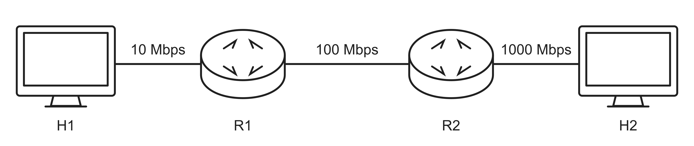
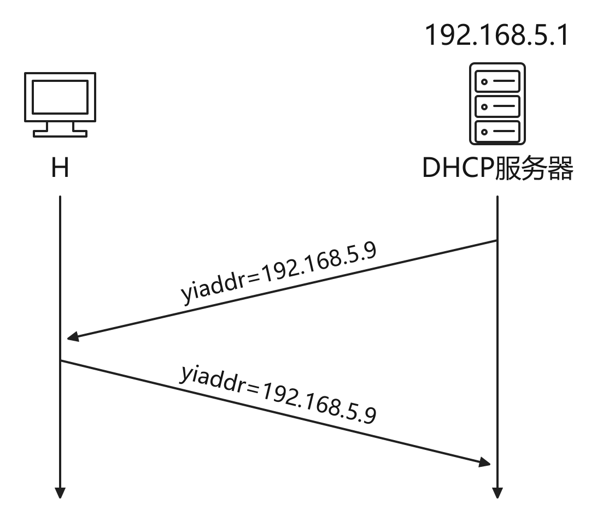
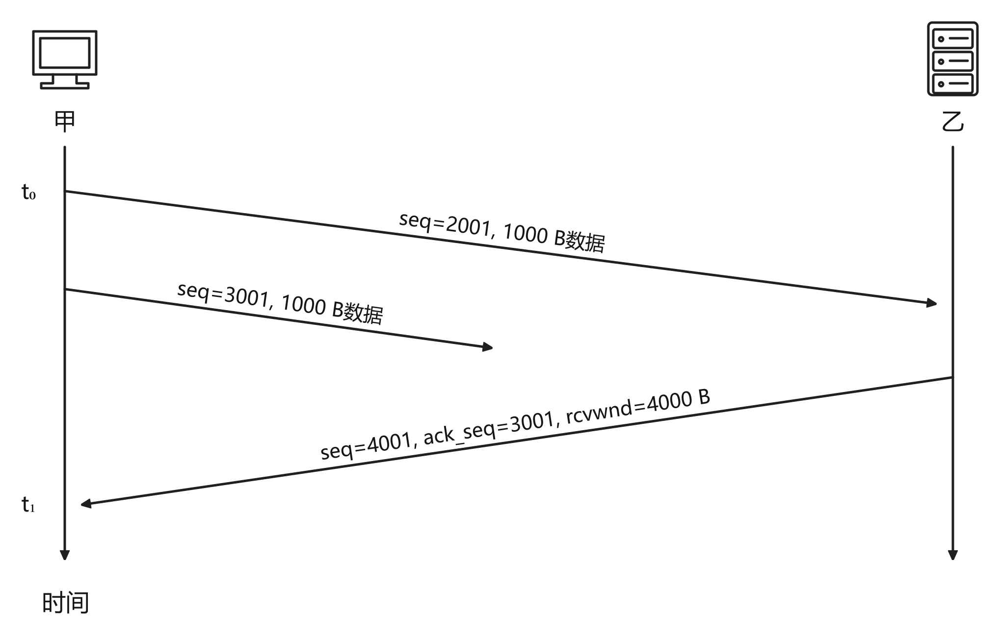
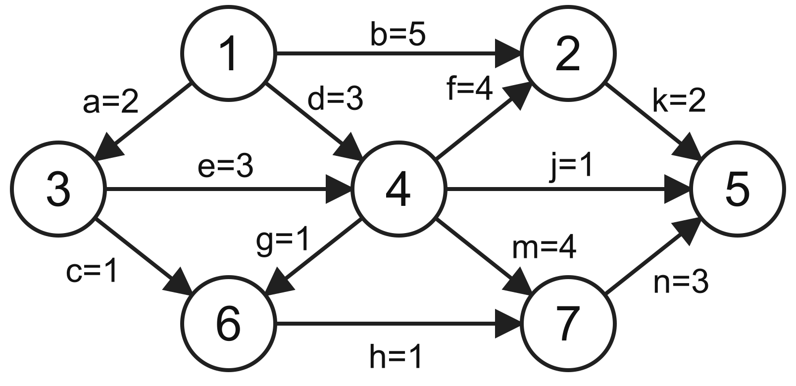
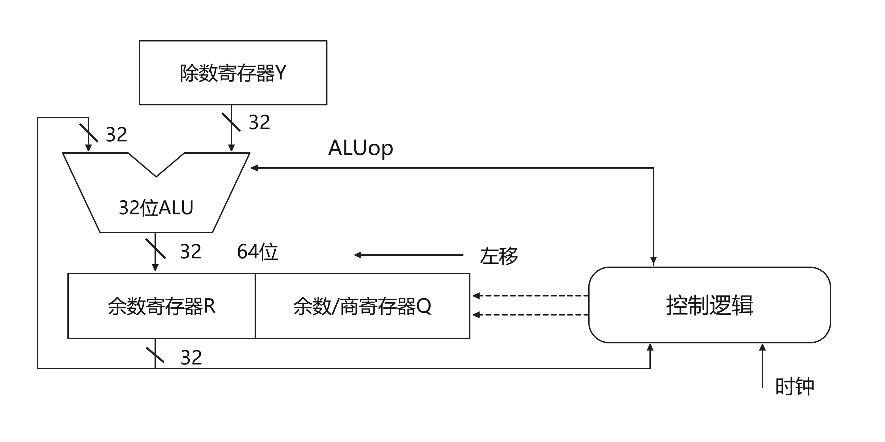
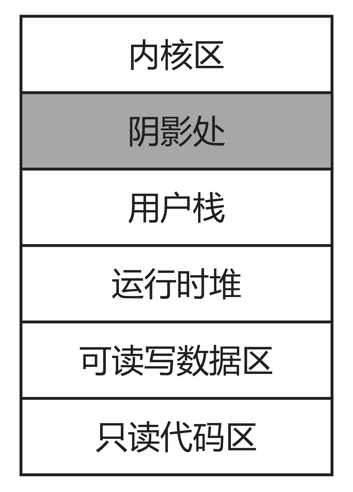
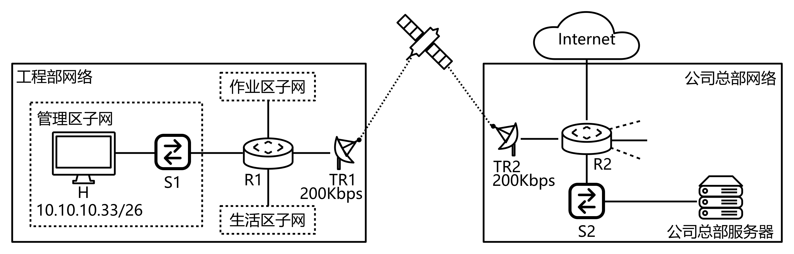

# 2025年408真题

> 来源：四〇八档案室 <https://zhenti.beokayy.club/paper/2025> 的结构化题面，抓取时间 2026-10-28。
> 与 2009–2023 年那份由官方 PDF 经 OCR 生成的版本不同，这份是网页整理的题面；
> 配图取自该站重绘图，存于 `图/2025/`。

## 一、单项选择题（第 1～40 小题，每小题 2 分，共 80 分）

### 1．下列程序段的时间复杂度是（ ）。

```c
int count = 0, i, j;
for (i = 1; i * i <= n; i++) {
    for (j = 1; j <= i; j++) {
        count++;
    }
}
```

- A. O(log n)
- B. O(n)
- C. O(nlog n)
- D. O(n2)

### 2．已知算法 A 用于检查字符串中各类括号是否匹配，A 执行过程中使用初始为空的栈保存 遇到的括号。若栈的容量是 3，则下列选项中，A 不能处理的是（）。

- A. (a+[b+(c+d)/e]+f)+g-h
- B. [a*((b+c)/(d-e)+f/g)]-h
- C. [a*(b-(c-d)*e/(f+g))-h]
- D. [a-(b+[c*(d+e)-f]+g+h)]

### 3．若二叉树的节点值均为正整数，采用顺序存储方式保存在数组 R 中，用 -1 表示节点不存在，则下列数组中，不能表示一棵二叉树的是（ ）。

- A. R[]={20, 15, 40, -1, -1, 35}
- B. R[]={15, 40, 10, 18, 35, -1, -1}
- C. R[]={15, 40, 10, -1, -1, -1, 12}
- D. R[]={17, 20, 35, -1, 18, 45, -1, -1, 19, 27}

### 4．下列关于森林与二叉树的说法中，正确的是（ ）。

- A. 完全二叉树不存在度为 1 的结点
- B. 任何一个森林一定能转化成一棵二叉树
- C. 二叉树的分支结点个数比叶结点个数少
- D. 表达式树的根中保存的是最先计算的运算符

### 5．设字符集 S 中包含 7 个字符，各字符出现的频次分别为 2，3，4，6，8，10，11。现为 S 中字符构造哈夫曼编码，编码长度大于等于 3 的字符个数为（ ）。

- A. 2
- B. 3
- C. 4
- D. 5

### 6．下列关于图，选项正确的是（）。

- A. 有向图必定存在入度为 0 的顶点
- B. 有向无环图的拓扑有序序列存在且唯一
- C. 各顶点的度均大于等于 2 的无向图必有回路
- D. 可用 BFS 算法求出带权图中的每一对顶点的最短路径

### 7．已知查找表中有 400 个元素，查找每个元素的概率相同。采用分块查找法，且均匀分块。若采用顺序查找法确定元素所在的块，且块内也采用顺序查找法，为使查找效率最高，则每块包含的元素个数应为（）。

- A. 8
- B. 10
- C. 20
- D. 25

### 8．7 个不同的关键字，能够构成的不同 4 阶 B 树的个数是（）。

- A. 7
- B. 8
- C. 9
- D. 10

### 9．下列关于散列法处理冲突的叙述中，正确的是（）。

- A. 只要线性表不满，线性探查再散列一定能找到一个空闲位置
- B. 只要线性表不满，二次探查再散列一定能找到一个空闲位置
- C. 线性探查再散列处理的冲突，一定是发生在同义词之间
- D. 二次探查再散列处理的冲突，一定是发生在非同义词之间

### 10．下列排序算法中，最坏情况下元素移动最少的是（）。

- A. 起泡排序
- B. 直接插入排序
- C. 快速排序
- D. 简单选择排序

### 11．对含 9 个关键字的初始序列进行排序，若序列的变化情况如下表所示，则采用的排序算法是（ ）。

| 排序阶段 | 序列 |
|---|---|
| 初始序列 | 5，25，40，30，10，20，45，15，35 |
| 第 1 趟排序后 | 5，10，20，30，15，35，45，25，40 |
| 第 2 趟排序后 | 5，10，15，25，20，30，40，35，45 |

- A. 希尔排序
- B. 基数排序
- C. 归并排序
- D. 折半插入排序

### 12．在 32 位计算机上执行下列 C 语言代码，则 ui 的真值为（ ）。

```c
short si = -32767;
unsigned int ui = si;
```

- A. 215+1
- B. 215
- C. 232-215-1
- D. 232-215+1

### 13．已知 float 型变量用 IEEE754 单精度浮点数格式表示。 若 float 型变量 x 的机器数为 4730 0000H；则 x 的值为（）。

- A. 0.375×2¹⁴
- B. 1.375×2¹⁴
- C. 0.375×2¹⁵
- D. 1.375×2¹⁵

### 14．假设 8 位字长的计算机中，两个带符号整数 x 和 y 的补码表示分别为[x]补=A3H，[y]补 =75H，则通过补码加减运算器得到的 x-y 的值及 OF 标志分别为（）。

- A. 24，0
- B. 24，1
- C. 46，0
- D. 46，1

### 15．某 32 位计算机按字节编址，采用小端方式存放数据，编译器按边界对齐方式为下列 C 语言结构体数组变量 employee 分配存储空间。

```c
struct record {
    int id;
    char name[10];
    int salary;
} employee[200];
```

数组 employee 的起始地址为 0000 A0B0H，employee[1].id 的机器数为 1234 5678H，则 56H 的地址是（ ）。

- A. 0000 A0C3H
- B. 0000 A0C4H
- C. 0000 A0C5H
- D. 0000 A0C6H

### 16．下列选项中，由指令集体系结构（ISA）规定的是（ ）。

- A. 是否采用阵列乘法器
- B. 是否采用微程序控制器
- C. 是否采用定长指令字格式
- D. 是否采用单总线数据通路

### 17．下列关于 RISC 的叙述中，错误的是（）。

- A. 多采用硬连线方式实现控制器
- B. 通常采用 Load/Store 型指令设计风格
- C. 难以采用流水线数据通路实现微架构
- D. 多采用寄存器传递过程调用时的参数

### 18．下列关于 CPI 和 CPU 时钟周期的叙述中，错误的是（）。

- A. 不同类型指令的 CPI 可能不一样
- B. 程序的 CPI 与 Cache 缺失率无关
- C. 单周期 CPU 的时钟周期以最耗时指令所用的时间为准
- D. 流水线 CPU 的时钟周期以最长流水段所用时间为准

### 19．下列关于 CPU 中的数据通路和控制器的叙述中，错误的是（）。

- A. 通用寄存器组中应该包含程序计数器
- B. 控制器中一定包含指令操作码的译码电路
- C. 单周期 CPU 中的控制器比多周期 CPU 中的更简单
- D. 流水线 CPU 需解决数据相关和控制相关等冒险问题

### 20．某处理器总线采用同步、并行传输方式，每个总线时钟周期传送 4 次数据（quad-pumped 技术）。若该总线的工作频率为 1333 MHz（实际单位是 MT/s，表示每秒传送 1333 M 次），总线宽度为 64 位，则总线带宽约为（ ）。

- A. 10.66GB/s
- B. 42.66 GB/s
- C. 85.31 GB/s
- D. 341.25 GB/s

### 21．适合采用 DMA 的设备有（ ）。

I. 键盘
II. 网卡
III. 固态硬盘
IV. 针式打印机

- A. I、II
- B. II、III
- C. II、IV
- D. III、IV

### 22．下列选项中，会触发外部中断请求的事件是（）。

- A. DMA 传送结束
- B. 总线事务结束
- C. 页故障的处理结束
- D. 执行断点指令

### 23．在采用页式虚拟存储管理方式的系统中，当发生上下文切换时，下列寄存器中操作系统不需要更新的是（ ）。

- A. 通用寄存器
- B. 页表基址寄存器
- C. 程序寄存器
- D. 内核中断向量表基址寄存器

### 24．关于虚拟化技术，错误的说法是（）。

- A. 操作系统可以在虚拟机上运行
- B. 一台主机可以支持多个虚拟机
- C. VMM 与操作系统特权级相同
- D. 通过虚拟机技术，可以用一台主机上模拟多种 ISA

### 25．某进程采用优先权调度，采用单链表保存进程就绪队列，高优先级进程在队头。就绪 队列长度为 n，则插入进程、选出进程的时间复杂度分别是（）。

- A. O（1），O（1）
- B. O（1）、O（n）
- C. O（n），O（1）
- D. O（n），O（n）

### 26．现有一 LRU 算法，固定分配局部置换，已为进程分配 3 个页框，页面访问序列为 {0，1，2，0，5，1，4，3，0，2，3，2，0}，其中 0，1，2 已调入内存。则缺页次数是（）。

- A. 5
- B. 6
- C. 7
- D. 8

### 27．确定进程运行所需的最少页框数时，要考虑的指标有（ ）。

- A. 代码长度
- B. 虚拟地址空间大小
- C. 物理地址空间大小
- D. 指令系统支持的寻址方式

### 28．关于虚拟文件系统，正确的是（）。

- A. 虚拟文件系统是运行在虚拟内存的文件系统
- B. VFS 可以加快文件系统的访问速度
- C. VFS 定义了可访问不同文件系统的统一接口
- D. VFS 只能访问本地文件系统，不能访问网络文件系统

### 29．某文件系统采用索引节点方式。用户在目录中新建文件 F 时，文件系统不会做的是（）。

- A. 初始化文件 F 的索引节点
- B. 在目录文件中写入 F 的索引节点号
- C. 在目录文件中写入 F 的访问权限信息
- D. 在目录文件中增加一条文件 F 对应的目录项

### 30．关于内存映射文件，下列说法正确的是（ ）。

I. 可实现进程间通信
II. 实现了页面到磁盘块的映射
III. 将文件映射到进程的虚拟地址空间
IV. 将文件映射到系统的物理地址空间

- A. I、III
- B. I、IV
- C. II、III
- D. I、II、III

### 31．下列选项中，文件系统能够知道外存空闲空间的使用情况的是（ ）。

- A. 目录
- B. 系统打开文件表
- C. 文件分配表（FAT）
- D. 文件控制块（FCB）

### 32．下列选项中，文件系统能为温彻斯特硬盘和固态硬盘提供的功能是（）。

- A. 划分扇区
- B. 确定盘块大小
- C. 降低寻道时间
- D. 实现均衡磨损

### 33．主机 H1 向 H2 发送一个 2 MB（1 M=106 B）文件，现有三种交换方式：

① 电路交换，连接建立时间为 32 μs，速率为 10 Mbps；
② 分组交换，分组长度为 400 B，忽略首部开销；
③ 报文交换。

分组交换及报文交换网络如下图所示，路由器 R1、R2 均采用存储转发方式。在不考虑分组拆装时间和传播时延的情况下，从 H1 发送开始到 H2 接收完为止，电路交换、分组交换和报文交换所需时间分别为 Tcs、Tps、Tms，则三者的大小关系为（ ）。



- A. Tcs>Tms>Tps
- B. Tms>Tps>Tcs
- C. Tms>Tcs>Tps
- D. Tps>Tms>Tcs

### 34．某差错编码的编码集为 {1001 1010, 0101 1100, 1111 0000, 0000 1111}，它的检错和纠错 能力是（）。

- A. 可检测不超过 2 位错，检错率 100%；可纠正不超过 1 位错
- B. 可检测不超过 2 位错，检错率 100%；可纠正不超过 2 位错
- C. 可检测不超过 3 位错，检错率 100%；可纠正不超过 1 位错
- D. 可检测不超过 3 位错，检错率 100%；可纠正不超过 2 位错

### 35．在某个 10BaseT 以太网的冲突域内，若主机甲向主机乙发送数据帧时发生了连续 11 次冲突，则甲再次尝试发送该数据帧的最大间隔时间是（ ）。

- A. 0.512ms
- B. 0.5632ms
- C. 52.3776ms
- D. 104.8064ms

### 36．一台新接入网络的主机 H 通过 DHCP 服务器动态请求 IP 地址过程中，与 DHCP 服务 器交换 DHCP 报文过程如下图所示。封装 DHCP 的 REQUEST 报文的 IP 数据报的目的 IP 地址和源 IP 地址分别是（）。



- A. 192.168.5.1, 0.0.0.0
- B. 192.168.5.1, 192.168.5.9
- C. 255.255.255.255,0.0.0.0
- D. 255.255.255.255, 192.168.5.9

### 37．假设路由器实现 NAT 功能，内网中主机 H 的 IP 地址为 192.168.1.5/24，若 H 运行某应用向 Internet 发送一个 UDP 报文段，则路由器在转发封装该 UDP 报文段的 IP 数据报的过程中，UDP 报文的首部字段会被修改的是（ ）。

I. 源端口号
II. 目的端口号
III. 总长度
IV. 校验和

- A. 仅 I、III
- B. 仅 I、IV
- C. 仅 II、III
- D. 仅 II、IV

### 38．主机甲通过 TCP 向主机乙发送数据的部分过程如下图，seq 为序号，ack_seq 为确认序号，rwnd 为接收窗口。甲在 t0 时刻的拥塞窗口和发送窗口均为 2000B，拥塞控制阈值为 8000B，MSS=1000B。甲始终以 MSS 发送 TCP 段。若甲在 t1 时刻收到如图所示的确认段，则甲在未收到新的确认段之前，还可以继续向乙发送的 TCP 段数是（ ）。



- A. 2
- B. 3
- C. 4
- D. 5

### 39．Time 是一个提供时间查询服务的 C/S 架构网络应用，支持客户通过 UDP 和 TCP 向 Time 服务器请求时间。若某客户与 Time 服务器通信往返时间为 8ms，则该客户分别通过 UDP 和 TCP 向该服务器请求服务，所需的最少时间分别是（）。

- A. 8ms，8ms
- B. 8ms，16ms
- C. 16ms，8ms
- D. 16ms，16ms

### 40．下列关于 POP3 协议的叙述，正确的是

I. 支持用户代理从邮件服务器读取邮件
II. 支持用户代理向邮件服务器发送邮件
III. 支持邮件服务器之间发送与接收邮件
IV. 支持通过一条 TCP 连接接收多封邮件

- A. 仅 I、IV
- B. 仅 II、III
- C. 仅 I、II、III
- D. 仅 I、III、IV

## 二、综合应用题（第 41～47 题，共 70 分）

### 41．设有两个长度均为 n 的一维整型数组 A 和 res，对数组 A 中的每个元素 A[i]，计算 A[i] 与 A[j]（0≤ i≤ j≤ n-1）乘积的最大值，并将其保存到 res[i] 中。例如，若 A[]={1, 4, -9, 6}，则得到 res[]={6, 24, 81, 36}。现给定数组 A，请设计一个时间和空间上尽可能高效的算法 calMulMax，求 res 中各元素的值。

函数原型为：

```c
void calMulMax(int A[], int res[], int n);
```

要求：

- 给出算法的基本设计思想；
- 根据设计思想，采用 C 或 C++ 语言描述算法，关键之处给出注释；
- 说明你所设计算法的时间复杂度和空间复杂度。

### 42．某工程包含 12 个活动，使用题 42 图所示的 AOE 网描述，图中各边上标注了活动及其持续时间。


请回答下列问题（活动均用活动名表示）：

(1) 完成该工程的最短时间是多少？哪些活动是关键活动？
(2) 若按照最短时间完成工程，则与活动 e 同时进行的活动可能有哪些？
(3) 时间余量最大的活动是哪个？其时间余量是多少？
(4) 假设工程从时刻 0 开始，因某种原因，活动 b 在时刻 6 开始。为保证工程不延期，在其他活动持续时间不变的情况下，b 的持续时间最多是多少？若不改变 b 的持续时间，则压缩哪个活动的持续时间也能保证工程不延期？

### 43．现有 C 语言程序 P 的部分代码如下。假定运行程序 P 的计算机 M 字长为 32 位，按字节编址；数据 Cache 的数据区大小为 32 KB，采用 8 路组相联映射方式，主存块大小为 64 B，Cache 命中时间为 2 个时钟周期，缺失损失为 200 个时钟周期；采用页式虚拟存储管理方式，页大小为 4 KB；数组 d 的起始虚拟地址为 0180 0020H（VA31～VA0）。

```c
int x, d[2048], i;
...
for (i = 0; i < 2048; i++)
    d[i] = d[i] / x;
...
```

请回答下列问题：

(1) 主存地址中 Cache 组号字段和块内地址字段分别占几位？虚拟地址中哪些位可作为 Cache 索引？
(2) d[100] 的虚拟地址是多少？d[100] 所在主存块对应的 Cache 组号是多少？
(3) 假设执行 for 语句时对应代码已在 Cache 中，变量 i 和 x 已装入寄存器，数组 d 已调入主存但不在 Cache 中，则 d[0] 在其所在主存块内的偏移量是多少（用十六进制表示）？for 语句执行过程中，访问数组 d 的 Cache 缺失率和数组元素的平均访问时间分别是多少（缺失率百分比保留两位）？
(4) 数组 d 分布在几个页中？若执行 for 语句时对应代码已经在主存，但数组 d 还未调入主存，则执行 for 语句过程中，访问数组 d 所引起的缺页次数是多少？

### 44．**补充条件（来源：2025 年第 43 题）**

运行程序 P 的计算机 M 字长为 32 位，按字节编址。程序 P 的相关代码如下：

```c
int x, d[2048], i;
...
for (i = 0; i < 2048; i++)
    d[i] = d[i] / x;
...
```

**本题题干**

对于题 43 中的计算机 M 和程序 P，假定 P 的部分机器级代码如下，其中 R0～R4 为通用寄存器，SEXT 表示按符号扩展；M 中补码除法器的逻辑结构如图所示。

```text
...
// x 在 R2 中，i 在 R4 中
// 数组 d 的首地址在 R3 中
mov  R1, (R3 + R4 * 4)    // R1 <- d[i]
scov R1                   // {R0, R1} <- SEXT(R1)
idiv R1, R3               // R1 <- ({R0, R1} / R2)
...
```


请回答下列问题，并说明理由：

(1) 若执行 idiv 指令的除运算时，d[i]=0x87654321，x=0xFF，则补码除法器中寄存器 R、Q 和 Y 的初始内容分别是什么（用十六进制表示）？图中哪个部件包含计数器？在补码除法器执行过程中，由 ALUop 所控制的 ALU 运算有哪几种？（4 分）
(2) 假设 idiv 指令执行过程中会检测并触发除法异常，则执行 idiv 指令时，哪些情况会发生除法异常（要求给出此时 d[i] 和 x 的十六进制机器数）？发生除法异常时，在异常响应过程中 CPU 需要完成哪些操作？（5 分）

### 45．三个人一起植树，甲挖坑，乙放树苗入坑并填土，丙负责为新种树苗浇水。步骤依次为：挖树坑、放树苗、填土和浇水。现有铁锹和水桶各一个，铁锹用于挖树坑和填土，水桶用于浇水。当树坑数量小于 3 时，甲才可以挖树坑。设初始坑数为 0，铁锹、水桶均可用。定义尽可能少的信号量，用 wait() 和 signal() 操作描述植树过程中三人的同步互斥关系，并说明所用信号量的作用及其初值。

### 46．某进程的虚拟地址空间如下图所示，阴影部分为未占用区域。


另有 C 程序代码：

```c
char *ptr;

void main()
{
    int length;
    ptr = (char *)malloc(sizeof(char));
    scanf("%s", ptr);
    length = strlen(ptr);
    printf("length=%d\n", length);
    free(ptr);
}
```

请回答下列问题，并说明理由：

- 上述程序执行时，其进程控制块位于哪个区域？执行 scanf() 等待键盘输入时，该进程处于什么状态？
- main() 函数的代码位于哪个区域？其直接调用的哪些函数的功能需要通过执行驱动程序实现？
- 变量 ptr 被分配在哪个区域？若变量 length 没有被分配在寄存器中，则会被分配在哪个区域？ptr 指向的字符串位于哪个区域？

### 47．某公司将工程部网络与公司总部网络互联，决定租用卫星通信链路连接工程部网络的路由器 R1 和公司总部网络的路由器 R2，如图所示。S1 和 S2 为千兆以太网交换机；TR1 和 TR2 是卫星信号地面收发设备，实现全双工调制解调。天通一号卫星的轨道高度是 36000 km，电磁波传播速度为 300000 km/s。租用的卫星链路为 R1 和 R2 之间提供对称全双工信道，每个方向的数据传输速率为 200 kb/s。


请回答下列问题，并说明理由：

- 忽略卫星信号中继、TR1、TR2 调制解调时间开销，则 R1 到 R2 之间的卫星链路单向传播时延是多少？主机 H 向总部服务器传输数据时可达到的最大吞吐量是多少？若忽略各层协议数据包的首部开销以及以太网内的传播时延，则主机 H 向总部服务器上传一个 4000B 的文件，至少需要多长时间？
- 现需要基于 GBN 为卫星链路设计单向可靠的链路层协议 SLP，支持 R1 向 R2 发送数据。SLP 数据帧长 1500B，忽略 ACK 帧长度。要求 SLP 单向信道利用率不低于 80%，则发送窗口至少为多少？SLP 帧序号字段至少需要多少位？
- 公司总部给工程部分配 IP 地址空间是 10.10.10.0/24，工程部再进一步划分为 3 个子网，其中生活区子网可分配 IP 地址数不少于 120 个，作业区子网和管理区子网可分配 IP 地址数均不少于 60 个，主机 H 已正确配置 IP。问作业区子网、管理区子网、生活区子网地址各是什么（给出 CIDR 地址形式）？
