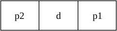
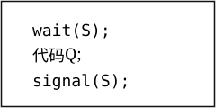
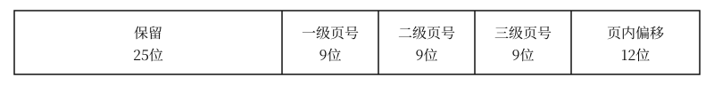
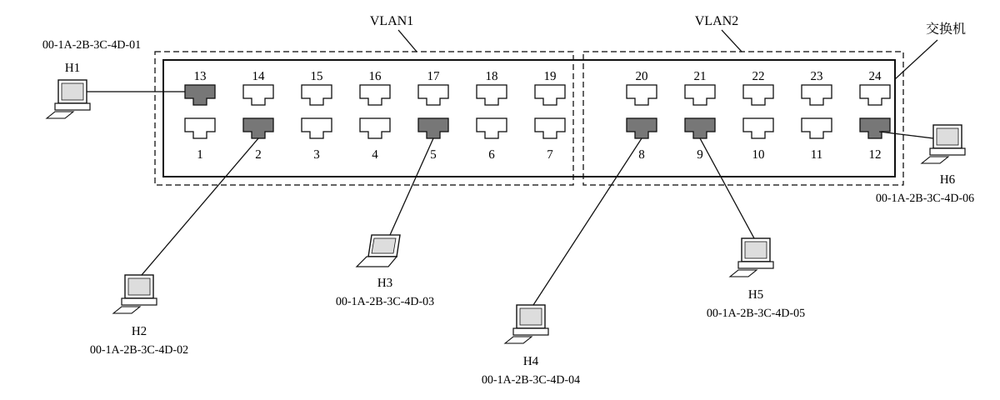
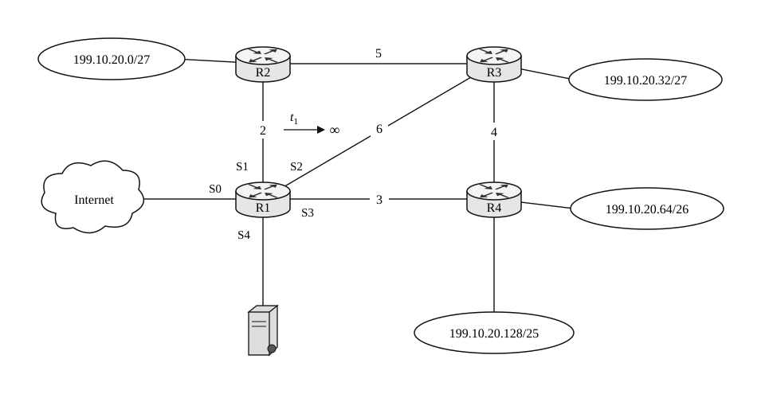
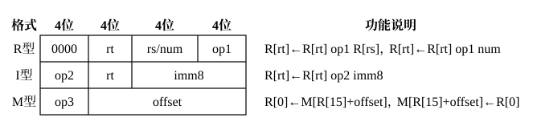
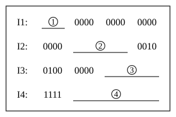
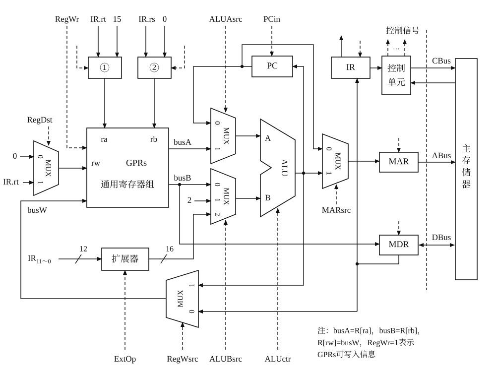
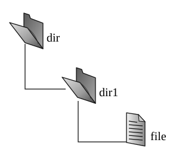
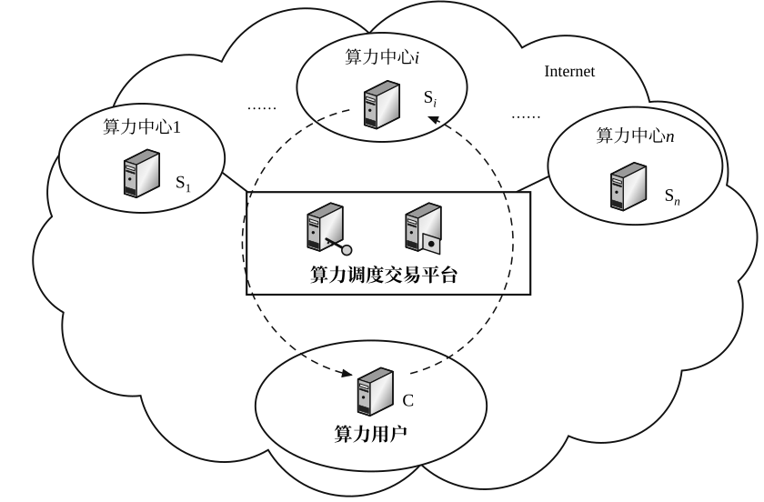

# 2026年408真题

> 来源：四〇八档案室 <https://zhenti.beokayy.club/paper/2026> 的结构化题面，抓取时间 2026-10-28。
> 与 2009–2023 年那份由官方 PDF 经 OCR 生成的版本不同，这份是网页整理的题面；
> 配图取自该站重绘图，存于 `图/2026/`。

## 一、单项选择题（第 1～40 小题，每小题 2 分，共 80 分）

### 1．线性表 L 含有 n（n≥ 3）个元素，采用顺序存储方式保存。在 L 中原有元素相对次序保持不变且仍有空闲存储空间的情况下，下列操作中，一定会移动多个元素的是

I. 在表头插入一个元素

II. 在表头删除一个元素

III. 在表尾插入一个元素

IV. 在表尾删除一个元素

- A. 仅 I、II
- B. 仅 I、III
- C. 仅 II、IV
- D. 仅 III、IV

### 2．已知带头结点的双向链表 L 含有 n（n≥ 3）个元素，结点结构为


其中，p2 和 p1 分别是指向其直接前驱和直接后继结点的指针，指针 head 指向头结点，指针 cu = head。现要将 L 各结点中的 p2 指针修改为指向 p1 所指结点的直接后继结点。当指针指向的结点不存在时，相应的指针值为 NULL。下列选项中，可以完成修改功能的是

- A. while (cu != NULL) { cu->p2 = cu->p1->p1; cu = cu->p1; }
- B. while (cu != NULL && cu->p2 != NULL) { cu->p2 = cu->p1->p1; cu = cu->p1; }
- C. while (cu != NULL) { if (cu->p1 != NULL) { cu->p2 = cu->p1->p1; cu = cu->p1; } }
- D. while (cu != NULL) { if (cu->p1 != NULL) cu->p2 = cu->p1->p1; else cu->p2 = NULL; cu = cu->p1; }

### 3．若二叉树 T 的中序遍历序列是 b,e,d,f,c,a,g，层序遍历序列是 a,b,g,c,d,e,f，则 T 的后序遍历序列是

- A. c,e,d,f,b,g,a
- B. c,e,f,d,b,g,a
- C. e,f,d,c,b,g,a
- D. e,g,f,d,b,c,a

### 4．已知由 5 棵树组成的森林 F 中各棵树所含的结点个数分别是 2，3，4，5，7。若 F 中各棵树的排列次序任意，则与 F 对应的二叉树的高度至少是

- A. 5
- B. 6
- C. 8
- D. 10

### 5．已知二叉树 T 中 7 个叶结点 a,b,c,d,e,f,g 的权值分别是 1，2，4，5，8，10，12，当 T 的带权路径长度最小时，与结点 e 深度相同的叶结点仅有

- A. d
- B. g
- C. d、f
- D. f、g

### 6．若用邻接表保存有向图 G=(V,E)，则计算 G 中某顶点入度的时间复杂度是

- A. O(|V|)
- B. O(min(|V|,|E|))
- C. O(|E|)
- D. O(max(|V|,|E|))

### 7．有向图 G=(V,E) 的顶点个数为 n（n≥ 2），指定一个顶点为初始点，指定若干个顶点（非初始点）为标记点，且每个顶点都在从初始点到标记点的有向路径上（一条有向路径上允许含有多个标记点）。每条有向边上均有一个字符，从初始点到任一标记点的有向路径上的所有字符组成一个字符串，所有这样的字符串构成字符串集 S。下列关于 S 的叙述中，错误的是

- A. 若 G 无环，则 S 是有穷集
- B. 若 G 无环，则 S 中存在长度等于 n 的字符串
- C. 若 G 有环，则 S 中存在长度大于 n 的字符串
- D. 若 G 有环，则 S 中存在长度小于 2n 的字符串

### 8．高度为 4 的平衡二叉树中，根结点左、右子树的结点个数相差最多是

- A. 1
- B. 2
- C. 3
- D. 5

### 9．使用直接插入排序算法分别对下列数据进行升序排序，元素之间比较次数最少的是

- A. 30，27，56，41，80，95，69
- B. 31，43，26，55，63，99，77
- C. 61，84，51，23，34，91，40
- D. 93，32，48，81，50，21，72

### 10．某考试考查了课程 C1 和 C2，C1、C2 成绩及总成绩（C1、C2 成绩之和）均保存在数组 M 中。现需根据考生的总成绩从高到低进行排名，总成绩相同者的排名由 C1 成绩从高到低决定，C1 成绩也相同者的排名由初始相对次序决定。假设先按 C1 成绩对 M 排序，再按总成绩对 M 排序，能得到正确的排名结果，则下列算法中，采用的是

- A. 基数排序
- B. 快速排序
- C. 希尔排序
- D. 选择排序

### 11．采用 k-路归并对外存中保存的数据进行排序，排序的趟数记为 d。下列叙述中，正确的是

I. 增大 k 的值可能减小 d 的值

II. 初始归并段的个数不影响 d 的值

III. 可用内存大小限制了初始归并段的最大长度

- A. 仅 I
- B. 仅 I、II
- C. 仅 I、III
- D. 仅 II、III

### 12．下列关于计算机系统层次结构的叙述中，错误的是

- A. 最上层是应用软件层，最下层是器件及物理封装层
- B. 指令集体系结构是软件和硬件之间的接口，且必不可少
- C. 计算机组成（即微架构）属于指令集体系结构的物理实现层
- D. 操作系统可通过指令集体系结构进行相应抽象，向上层软件提供服务

### 13．对机器数 1010 0110B 先算术右移 3 位，再算术左移 2 位，最终结果是

- A. 1101 0000B
- B. 1101 0011B
- C. 0101 0000B
- D. 0101 0011B

### 14．已知 float 型变量用 IEEE 754 单精度浮点格式表示，采用就近舍入（中间值取偶数）方式。若 float 型变量 x 值为 12.1（提示：0.1 = 0.000 1100 1100 1100 1100 1100⋯B），则 x 的机器数是

- A. 4141 9999H
- B. 4141 999AH
- C. 41E0 CCCCH
- D. 41E0 CCCDH

### 15．若用 8 个 64M× 8 位的 DRAM 芯片按交叉编址方式构成主存储器，并与一个宽度为 64 位的存储器总线相连，主存每次最多读写 64 位，且按字节编址，则下列地址中，与主存地址 0018 001DH 位于同一芯片中的是

- A. 0000 01D5H
- B. 000F A020H
- C. 0018 001EH
- D. 0F02 0014H

### 16．对于下列选项中给出的相关内容，**不是**由指令集体系结构规定的是

- A. 指令集中是否包含输入和输出指令
- B. 采用向量中断还是非向量中断方式
- C. 采用段式还是页式虚拟存储管理方式
- D. 指令流水线是否采用超级流水线技术

### 17．下列指令中，执行后有可能按存放顺序执行其下一条指令的是

I. 条件跳转指令

II. 过程调用指令

III. 陷阱（Trap）指令

IV. 过程返回指令

- A. 仅 I、II
- B. 仅 I、IV
- C. 仅 II、III
- D. 仅 III、IV

### 18．某计算机按字节编址，数据 Cache 共有 1024 行，采用 4 路组相联映射方式，主存块大小为 32 B。若需要访问主存地址为 1028 的 4 字节数据，则该数据所在主存块对应的 Cache 组号是

- A. 4
- B. 16
- C. 32
- D. 64

### 19．某计算机按字节编址，虚拟地址为 16 位，页大小为 256 B，页表项中包含装入位（P）、页框号（PPN）等字段，TLB 采用 4 路组相联映射方式，共有 16 个 TLB 表项，TLB 表项中包含标记（Tag）、有效位（V）等字段。在 TLB 表项与主存页表同步后，若主存页表中页号 22 对应的页表项中 P = 0、PPN = 2AH，则下列选项中，**不可能**出现在组号为 2 的 TLB 表项中的是

- A. Tag = 05H、V = 1、PPN = 1CH
- B. Tag = 06H、V = 1、PPN = 2AH
- C. Tag = 16H、V = 0、PPN = 2AH
- D. Tag = 1AH、V = 0、PPN = 1CH

### 20．在不考虑异常/中断处理和访存额外开销的前提下，下列关于数据通路结构与 CPI 之间关系的叙述中，正确的是

I. 单周期数据通路计算机的 CPI 等于 1

II. 多周期数据通路计算机的 CPI 大于 1

III. 流水线数据通路计算机的 CPI 等于 1

- A. 仅 I、II
- B. 仅 I、III
- C. 仅 II、III
- D. I、II、III

### 21．I/O 子系统中，由驱动程序和中断服务程序直接控制外设与主机之间的输入/输出操作，其中需要用到一些特权指令。下列指令中，不属于特权指令的是

- A. I/O 指令
- B. 关中断指令
- C. 中断返回指令
- D. 系统调用指令

### 22．中断控制 I/O 方式下，实现 I/O 需要硬件和软件协同完成。中断响应及处理过程所包含的下列工作中，必须由硬件完成的是

- A. 开中断
- B. 中断判优
- C. 保存断点
- D. 保存通用寄存器

### 23．下列程序中，在内核模式执行的是

- A. 编译程序
- B. 链接程序
- C. 装入程序
- D. 命令解释程序

### 24．下列是支持虚拟存储管理的系统中指令执行过程的相关叙述，其中正确的是

- A. 虚实地址转换由操作系统完成
- B. 存储访问权限由操作系统检测
- C. 指令的合法性由操作系统验证
- D. CPU 产生的异常由操作系统处理

### 25．下列关于线程的叙述中，正确的是

- A. 用户级线程和内核级线程均由操作系统创建
- B. 多个内核级线程可以映射到同一个用户级线程
- C. 同一进程的不同内核级线程共用该进程的内核栈
- D. 同一进程的不同线程共享该进程虚拟地址空间中的堆

### 26．某系统中有 8 个进程均会执行如右图所示的代码片段，其中信号量 S 的初值为 5。若某时刻 S 的值为 -2，已执行到代码 Q 中的进程有 m 个，因执行 wait(S) 而被阻塞的进程有 n 个，则 m 和 n 的值分别是



- A. 5、2
- B. 5、3
- C. 6、2
- D. 7、1

### 27．若进程 P 读、写数据的集合分别记为 R(P) 和 W(P)，进程 Q 读、写数据的集合分别记为 R(Q) 和 W(Q)，则进程 P 和 Q 并发执行时**不会**发生并发错误的充要条件是

I. W(P)∩W(Q)=∅

II. R(P)∩W(Q)=∅

III. W(P)∩R(Q)=∅

IV. R(P)∩R(Q)=∅

- A. I、IV 同时成立
- B. II、III 同时成立
- C. I、II、III 同时成立
- D. I、II、III、IV 同时成立

### 28．某 64 位系统采用三级页式存储管理方式，虚拟地址结构如下图所示。


若各级页表项均占 8 字节，则进程的第三级页表占用的页框数最多是

- A. 512
- B. 32 K
- C. 256 K
- D. 128 M

### 29．下列页式虚拟存储管理系统的技术中，可用于降低系统平均访存时间的是

I. TLB

II. 多级页表

III. 工作集模型

IV. 页缓冲队列

- A. 仅 I、II
- B. 仅 I、IV
- C. 仅 II、III
- D. 仅 I、III、IV

### 30．假设两个进程共享一个页 S，其页表分别为 PT1 和 PT2，S 在两个进程虚拟地址空间中的起始地址分别为 VA1 和 VA2，则下列叙述中，正确的是

- A. VA1 和 VA2 相同
- B. VA1 和 VA2 映射到的物理地址相同
- C. S 在 PT1 和 PT2 中的页表项内容相同
- D. S 在 PT1 和 PT2 中的页表项虚拟地址相同

### 31．下列关于驱动程序的叙述中，错误的是

- A. 驱动程序中包含启动设备的代码
- B. 驱动程序中包含一组读/写设备的代码
- C. 驱动程序与内核之间需要定义统一的接口
- D. 块设备和字符设备驱动程序采用相同的 I/O 控制方式

### 32．下列操作中，由鼠标中断处理程序完成的是

- A. 将当前进程的状态由执行态改为阻塞态
- B. 将 CPU 运行模式由用户模式改为内核模式
- C. 将接收到的输入数据存放到设备接口的数据寄存器中
- D. 将输入数据从设备接口的数据寄存器传送到内核数据区

### 33．下列关于分层网络体系结构的叙述中，错误的是

- A. 有利于标准化
- B. 层次越多效率越高
- C. 有利于各层技术独立演化
- D. 降低网络系统设计与实现的复杂度

### 34．若在带宽为 200 kHz、信噪比 S/N=1023 的信道上发送一个长度为 1500 B 的分组，则发送该分组的传输时延至少是

- A. 0.375 ms
- B. 0.75 ms
- C. 3 ms
- D. 6 ms

### 35．假设某采用 CSMA/CA 的 IEEE 802.11 无线局域网，数据传输速率为 300 Mbps，DIFS =128 μs，SIFS =28 μs，忽略除数据帧外的其他帧的传输时延以及信号传播时延。若主机 H 发送一个总长度为 1500 B 的数据帧，则 H 从开始发送数据帧时刻起，到确认接收方接收到该帧为止，所需的时间至少是

- A. 40 μs
- B. 68 μs
- C. 168 μs
- D. 196 μs

### 36．支持 VLAN 划分的以太网交换机，已按端口划分了 2 个 VLAN。VLAN 划分结果及部分端口连接主机的 MAC 地址如下图所示。


下列具有不同目的 MAC 地址（DA）和源 MAC 地址（SA）的以太网帧 F1～F4 中，H3 会接收到的是

F1：DA = 00-1A-2B-3C-4D-03，SA = 00-1A-2B-3C-4D-01

F2：DA = 00-1A-2B-3C-4D-03，SA = 00-1A-2B-3C-4D-05

F3：DA = FF-FF-FF-FF-FF-FF，SA = 00-1A-2B-3C-4D-02

F4：DA = FF-FF-FF-FF-FF-FF，SA = 00-1A-2B-3C-4D-06

- A. 仅 F1、F2
- B. 仅 F1、F3
- C. 仅 F2、F4
- D. 仅 F3、F4

### 37．某网络在 t0 时刻的网络拓扑以及 R1 的路由表如下图所示，R1～R4 为路由器，基于链路状态路由算法计算路由，S0～S4 为 R1 的接口，链路上的数值为链路费用。若 t1（t1>t0）时刻 R1 检测到连接 R1 和 R2 的链路断开，则 R1 经过重新计算路由并进行充分路由聚合后的路由表中路由项（入口）的数量是


R1 路由表

| 目的网络 | 接口 |
|---|---|
| 199.10.20.0/27 | S1 |
| 199.10.20.32/27 | S2 |
| 199.10.20.64/26 | S3 |
| 199.10.20.128/25 | S3 |
| 199.10.21.125/32 | S4 |
| 0.0.0.0/0 | S0 |

- A. 3
- B. 4
- C. 5
- D. 6

### 38．下列路由协议中，可以将一个自治系统划分为多个区域（Area）的内部网关协议是

I. OSPF

II. RIP

III. BGP

- A. 仅 I
- B. 仅 II
- C. 仅 I、III
- D. 仅 II、III

### 39．若将 IP 网络 123.4.4.0/22 划分为规模均等的 32 个子网，则 IP 地址 123.4.5.211 所在的子网是

- A. 123.4.4.192/27
- B. 123.4.4.192/28
- C. 123.4.5.192/27
- D. 123.4.5.192/28

### 40．电子商务类 Web 应用通常采用 Cookie 技术解决 HTTP 协议无状态的问题。下列叙述中，不属于 Cookie 技术典型用途的是

- A. 用户跟踪
- B. 个性化推荐
- C. 构建虚拟购物车
- D. 缩短 Web 对象响应时间

## 二、综合应用题（第 41～47 题，共 70 分）

### 41．已知二叉搜索树采用二叉链表存储，类型定义如下：

```c
typedef struct BSTNode                 //二叉搜索树结点
{   int data;                          //保存结点的关键字值
    struct BSTNode * left, * right;    //指向左孩子、右孩子的指针
} BinTNode;
typedef BinTNode * BTree;              //二叉搜索树
```

对于给定的非空二叉搜索树 T（root 为指向 T 的根结点的指针）和整数 k，请设计尽可能高效的查找算法：

void searchX( BTree root, int k )

查找 T 中其关键字值与 k 之差的绝对值最小的所有结点，输出差值的绝对值和结点中的关键字值。要求：

（1）给出算法的基本设计思想。（4 分）

（2）根据设计思想，采用 C 或 C++ 语言描述算法，关键之处给出注释。（9 分）

### 42．一个栈的入栈序列是 1,2,…,n（n≥ 3）。请回答下列问题。

（1）当 n=9 时，是否能得到出栈序列 2,3,1,6,4,7,5,9,8？是否能得到出栈序列 2,3,1,5,6,7,4,9,8？（2 分）

（2）对于由 1,2,…,n 组成的任意序列 P1,P2,…,Pn 中的元素 Pi、Pj、Pk（i<j<k），当 Pi、Pj、Pk 的大小满足什么关系时，序列 P1,P2,…,Pn 不是可以得到的出栈序列？（2 分）

（3）当 n=4 时，可以得到的以 2 开头的出栈序列的个数是多少？（2 分）

（4）若当 n=k-1 时可以得到的出栈序列个数为 M，则当 n=k 时可以得到的以 1 开头的出栈序列的个数是多少？可以得到的以 2 开头的出栈序列的个数是多少？可以得到的所有出栈序列的个数是多少？（4 分）

### 43．某 16 位计算机 C 按字节编址，通用寄存器 R0～R15 的编号为 0～15，存储器地址为 16 位，采用定长指令字，指令格式有 R、I 和 M 型，如下所示。


其中，op1 为 0001、0010 分别表示加、左移指令，op2 为 0100 表示加立即数指令，op3 为 1110、1111 分别表示取数、存数指令，R[r] 表示寄存器 r 中的内容，num 为移位位数，M[addr] 表示存储器地址 addr 中的内容。请回答下列问题。

（1）主存单元和通用寄存器的宽度各是多少位？（2 分）

（2）op1 和 op2 的编码是否可以相同？op2 和 op3 的编码是否可以相同？（2 分）

（3）若 R[2] = ABCDH，R[9] = F001H，则指令 0000 0010 1001 0001 执行后，R2 和 R9 中内容分别是多少（用十六进制表示）？（2 分）

（4）若变量 x、y 均为 16 位带符号整数，在存储器中依次从低地址向高地址连续存放，x 的地址在 R15 中，实现“y = 16 * x - 5;”的 4 条指令 I1～I4 如题 43 表所示，写出①～④处的内容。（4 分）

题 43 表



### 44．**补充条件（来源：2026 年第 43 题）**

某 16 位计算机 C 按字节编址，通用寄存器 R0～R15 的编号为 0～15，存储器地址为 16 位，采用定长指令字，指令格式有 R、I 和 M 型，如下所示。


其中，op1 为 0001、0010 分别表示加、左移指令，op2 为 0100 表示加立即数指令，op3 为 1110、1111 分别表示取数、存数指令，R[r] 表示寄存器 r 中的内容，num 为移位位数，M[addr] 表示存储器地址 addr 中的内容。

**本题题干**

假定题 43 中计算机 C 的部分数据通路如题 44 图所示。


图中带箭头虚线表示控制信号，IR.rt、IR.rs 分别表示 IR 中的 rt、rs 字段，IR11∼ 0 为 IR 中低 12 位。要求取指令周期内完成 PC 增量操作。请回答下列问题。

（1）题 44 图中①和②是同一类部件，其名称是什么？（1 分）

（2）已知 I 型指令中 imm8 可以是带符号整数或无符号整数，M 型指令中 offset 是带符号整数，控制信号 ExtOp 至少有几位？为什么？（2 分）

（3）取指周期中，MARsrc、ALUAsrc、ALUBsrc、RegWr 的取值各是什么？（4 分）

（4）左移指令执行周期中，ALUBsrc、RegWsrc、RegDst、RegWr 的取值各是什么？ExtOp 是否可以与 M 型指令的 ExtOp 取值相同？为什么？（6 分）

### 45．某系统采用基于抢占式优先权（优先权值越大优先权越高）和时间片轮转的 CPU 调度算法，仅在时钟中断发生时才能抢占 CPU，时钟中断间隔时间为 10 ms。每当进程进入就绪队列时，其时间片大小均设置为 50 ms。进程因时间片用完而再次进入就绪队列时，若其优先权值大于 0，则优先权值减 1。进程因优先权低被抢占 CPU 而再次进入就绪队列时，其优先权值不变。优先权相同时，先进入就绪队列的进程先执行。假设系统中有 4 个进程 P1～P4，各进程的到达时刻、初始优先权值、所需的 CPU 执行时间如题 45 表所示。

题 45 表

| 进程 | 到达时刻 | 初始优先权值 | CPU 执行时间 |
|---|---|---|---|
| P1 | 10 ms | 3 | 95 ms |
| P2 | 10 ms | 4 | 20 ms |
| P3 | 12 ms | 2 | 40 ms |
| P4 | 14 ms | 5 | 60 ms |
请回答下列问题。

（1）在忽略时钟中断处理及 CPU 调度时间开销的情况下，若将 10 ms 时刻发生的时钟中断记为第一次时钟中断，且从此时开始进行 CPU 调度，则从 10 ms 时刻开始到 4 个进程都运行结束为止，时钟中断和 CPU 调度各发生了多少次？第一次执行 P1、P3、P4 的时刻分别是什么？（5 分）

（2）若时间片由 50 ms 改为 100 ms，则 CPU 调度次数增加、不变还是减少？若时钟中断间隔时间由 10 ms 改为 1 ms，则系统开销增加、不变还是减少？（2 分）

### 46．某基于索引节点（inode）的文件系统的目录项由文件名和索引节点号构成。磁盘中存放了索引节点表、位图、目录等元数据以及文件数据，盘块大小为 4 KB，盘块号占 4 B。索引节点表包含了所有文件的索引节点，位于从 100 号盘块开始的 4096 个连续盘块中，索引节点号是索引节点在该表中的序号，从 0 开始编号。每个索引节点占 128 B，包含直接地址项 5 个，一次间接地址项、二次间接地址项、三次间接地址项各 1 个。磁盘块位图和索引节点位图分别用于描述磁盘块和索引节点占用情况，0 表示未占用，1 表示已占用。某子目录树如题 46 图所示，其中各文件的文件名和索引节点号如题 46 表所示，file 大小为 30 KB。


题 46 表

| 文件名 | 索引节点号 |
|---|---|
| dir | 100 |
| dir1 | 201 |
| file | 1000 |
请回答下列问题。

（1）file 的索引节点存放在磁盘的几号盘块中？若 file 的索引节点已读入内存，则访问 file 中偏移地址为 21460 的一个字节数据，最多需要访问几个盘块？该文件系统在空间足够大的磁盘中最多能创建多少个文件？（3 分）

（2）若要删除目录 dir1，则文件系统需要对哪些元数据执行哪些操作？（5 分）

### 47．人工智能（AI）是引领未来的战略性技术，其发展高度依赖强大的算力供给，通过网络互联分散的算力中心，可以充分聚合算力资源，满足人工智能对大规模算力的需求，支撑人工智能国家发展战略。某算力调度交易平台聚合各地的算力中心的算力，向用户提供算力服务的示意场景如题 47 图所示。算力用户 C 向平台申请算力服务，平台通过优化调度各算力中心算力，向 C 授权使用算力中心 i 的算力，Si 为算力中心 i 的负载均衡服务器，用于接收算力用户的计算任务描述数据文件，并向算力中心 i 内部分派计算任务。为确保可靠传输，假设 C 建立一条 TCP 连接向服务器 Si 上传一个总长度为 2000 B 的计算任务描述数据文件，拥塞窗口初始阈值为 8 MSS，MSS = 500 B，Si 对收到的每个 TCP 段进行确认，且确认段不封装数据，接收窗口 rwnd 始终为 1000 B，RTT = 5 ms。C 建立连接时选择的初始序号为 1000，Si 选择的初始序号为 2000，SYN、ACK、FIN 为标志位，seq 为序号，ack_seq 为确认序号。在整个文件传输过程中未出现任何重传或报文段丢失。


请回答下列问题。

（1）C 与 Si 建立 TCP 连接过程需要几次握手？C 收到的 SYN = 1、ACK = 1 的 TCP 段的确认序号（ack_seq）是多少？（2 分）

（2）当 C 接收到 Si 发送的“ACK = 1，seq = 2001，ack_seq = 2001，rwnd = 1000”确认段后，C 的拥塞窗口增加到多少？C 的发送窗口设置为多少？（2 分）

（3）C 与 Si 释放 TCP 连接过程需要几次挥手？C 收到的最后一个 TCP 报文段的序号（seq）、确认序号（ack_seq）、FIN 的值分别是多少？（4 分）

（4）若忽略报文段传输时延，且时间从 C 请求建立 TCP 连接时刻算起，则 C 确认 Si 已成功接收到文件的时间是多少？（1 分）
